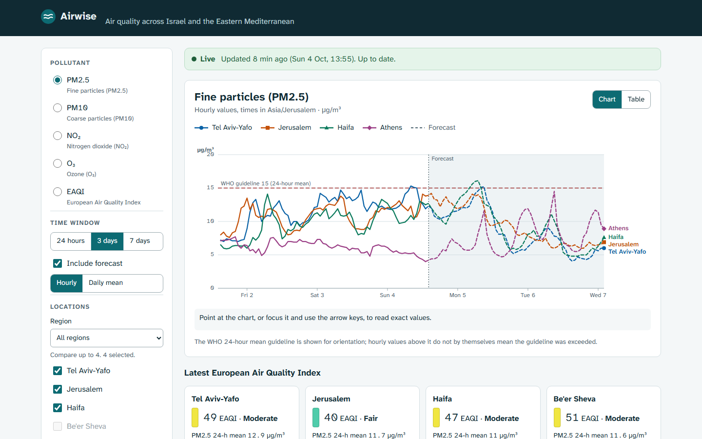
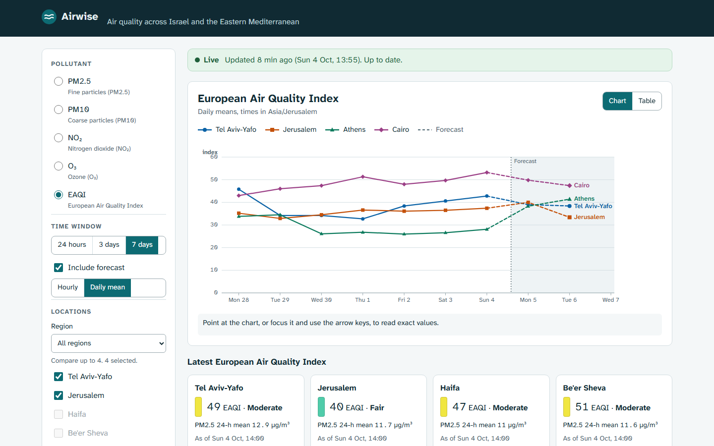
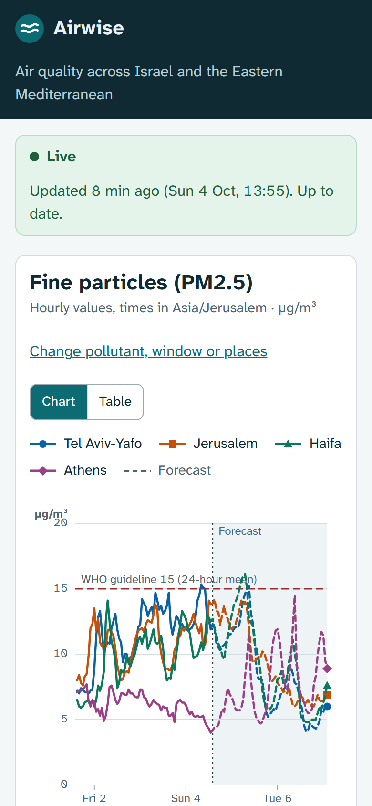

# Airwise

Compare air quality across Israel and the Eastern Mediterranean: hourly and daily PM2.5, PM10, NO₂, ozone and
the European Air Quality Index for ten cities, with forecasts, from the open Open-Meteo Air Quality API.



**Specialisation shown:** integrating an external API and processing its data, with caching, failure handling
and a small Python backend as supporting skills.

## What it does

- Fetches all ten locations in **one** provider request, validates the response against a strict schema and
  maps it to an internal observation model stored in SQLite.
- Filters by region, pollutant, time window (24 h, 3 days, 7 days), forecast on or off, hourly or daily mean.
- Compares up to four locations in an accessible SVG chart (colour plus marker shape, direct labels, keyboard
  cursor with spoken values) or an equivalent data table.
- Shows where the data came from and how old it is on every view: live, saved data after a failure, or the
  bundled offline snapshot.
- Survives provider trouble: timeouts, bounded retries with jittered backoff, Retry-After handling, a local call
  budget, a circuit breaker and request coalescing (many readers, one upstream call).
- Refreshes on a schedule only while the service runs, and never more often than the cache policy needs.

| Daily means with forecast | Phone |
| --- | --- |
|  |  |

## Engineering evidence

| Topic | Where |
| --- | --- |
| Provider contract (schema validation) | [src/airwise/provider/schema.py](src/airwise/provider/schema.py) |
| Timeouts, retries, backoff, 429, budget, circuit breaker | [provider/client.py](src/airwise/provider/client.py), [provider/resilience.py](src/airwise/provider/resilience.py) |
| Cache policy, single-flight refresh, fallbacks | [src/airwise/service.py](src/airwise/service.py), [docs/DECISIONS.md](docs/DECISIONS.md#cache-policy) |
| Data processing (daily means with coverage rule) | [src/airwise/aggregate.py](src/airwise/aggregate.py) |
| Failure tests with mocked HTTP | [tests/test_client.py](tests/test_client.py), [tests/test_service.py](tests/test_service.py) |
| Controlled outage drill | `./scripts/ops.ps1 outage-on`, [docs/OPERATIONS.md](docs/OPERATIONS.md#outage-drill) |

## Stack

Python 3.14, FastAPI, httpx, Pydantic, SQLite (standard library), uv with a lockfile. React 19, Vite,
`d3-scale` and `d3-shape` for chart maths with hand-written SVG, Atkinson Hyperlegible Next served locally.
pytest with respx, Vitest, Playwright with axe-core. Docker Compose and GitHub Actions.

## Quick start

Requirements: Docker. No API key or secret is needed.

```powershell
./scripts/ops.ps1 setup        # or: docker compose up -d --build --wait
```

Open **http://127.0.0.1:8102**. For a demo without internet: set `AIRWISE_PROVIDER_MODE=snapshot` in `.env`
and run `./scripts/ops.ps1 start`.

```powershell
./scripts/ops.ps1 start | stop | status | logs | backup | test
./scripts/ops.ps1 restore backups/<file>.db -Yes
./scripts/ops.ps1 outage-on | outage-off      # failure demo against an unreachable provider
./scripts/ops.ps1 reset-demo -Yes
```

## Tests

| Suite | Count | Command |
| --- | --- | --- |
| Python (schema, client failures, service, scheduler, API, backup) | 59 | `uv run pytest` |
| Web unit (scales, ticks, time zones, label layout) | 16 | `cd web; npm test` |
| E2E (desktop and phone, axe-core) | 7 | `cd web; npm run test:e2e` |

See [docs/TESTING.md](docs/TESTING.md).

## Documentation

[Architecture](docs/ARCHITECTURE.md) · [Decisions](docs/DECISIONS.md) · [Setup](docs/SETUP.md) ·
[API](docs/API.md) · [Security](docs/SECURITY.md) · [Testing](docs/TESTING.md) ·
[Operations](docs/OPERATIONS.md) · [Deployment](docs/DEPLOYMENT.md) · [Design](docs/DESIGN.md) ·
[Demo script](docs/DEMO.md) · [Exercises](docs/EXERCISES.md) · [Slim profile](docs/SLIM.md) ·
[Storage](docs/STORAGE.md) · [Changelog](CHANGELOG.md)

## Data source and limitations

Air quality data: Open-Meteo Air Quality API, based on Copernicus Atmosphere Monitoring Service (CAMS)
forecasts, licensed CC BY 4.0. Free use is limited to non-commercial purposes; this is a non-commercial
portfolio demo. Values are modelled on a grid of roughly 10-40 km, **not** station measurements, and are not
suitable for health decisions.

- One provider; no cross-checking against monitoring stations.
- Daily means are computed in one display time zone (Asia/Jerusalem) for all cities.
- The manual refresh endpoint is unauthenticated, protected by a server-side cooldown and the call budget.

No licence has been chosen for this code yet. Font licences: [docs/DESIGN.md](docs/DESIGN.md#assets-and-licences).
