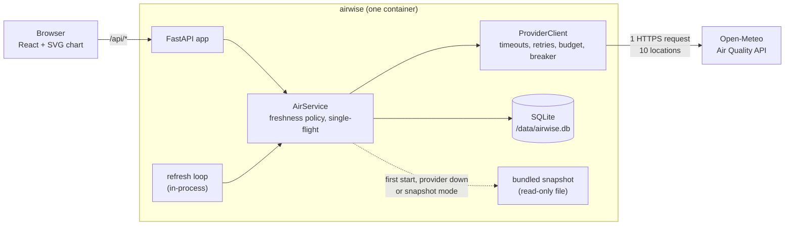
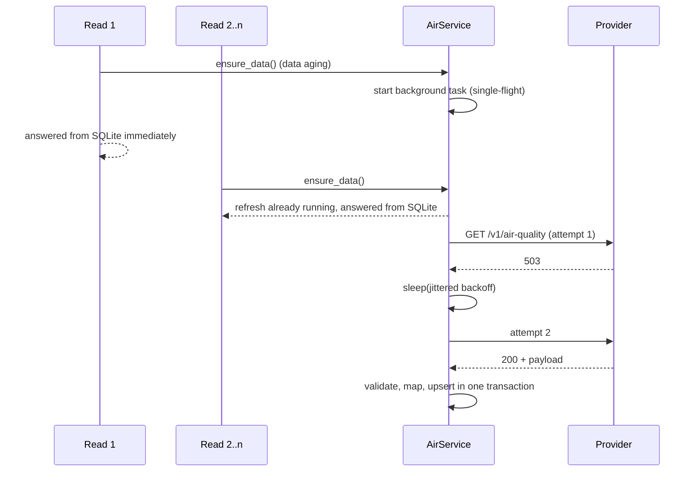

# Architecture

## Components and data flow

1. A refresh (scheduled, read-triggered or manual) calls the provider once for all ten locations.
2. The raw JSON is validated by Pydantic models ([provider/schema.py](../src/airwise/provider/schema.py)):
   array lengths, strictly increasing UTC timestamps, expected units, no negative concentrations, right
   number of locations, coordinates within 0.5° of the request.
3. Valid data is flattened into `(location, metric, timestamp, value)` rows and upserted in one SQLite
   transaction, together with a `fetches` row (time, source, SHA-256 of the payload) and retention cleanup.
4. Reads (`/api/series`, `/api/summary`) are served from SQLite. They never wait for the provider unless
   there is no data at all.

## Internal model

| Table | Purpose |
| --- | --- |
| `observations (location_id, metric, ts, value)` | Primary key on all three identifiers; `WITHOUT ROWID` keeps it compact. Newer fetches overwrite forecasts for the same hour. |
| `fetches` | When each dataset arrived and from where (`live` or `snapshot`). Points after `fetched_at` are forecasts relative to that fetch. |
| `refresh_log` | Every refresh attempt: trigger, outcome, detail, number of HTTP attempts. Shown in the status panel. |

Timestamps are Unix seconds in UTC (`timeformat=unixtime` on the request removes any time zone ambiguity).
Conversion to local time happens only for display and for daily buckets.

## Freshness states

| State | Condition | UI |
| --- | --- | --- |
| `fresh` | live data younger than `fresh_ttl_s` (30 min) | green "Live" |
| `aging` | 30 min to 6 h | green, "refresh due"; a background refresh is triggered by the read |
| `stale` | 6 h to 48 h | amber "Saved data" with the last provider error |
| `expired` | older than 48 h | red "Outdated", forecasts flagged as outdated |
| `snapshot` | data came from the bundled file | amber "Offline snapshot" with capture time |

## Refresh coordination

`refresh()` keeps one `asyncio.Task`; concurrent callers await the same task through `asyncio.shield`, so a
disconnecting client cannot cancel work others depend on.

## Process model

One Uvicorn process, one event loop. SQLite work runs in worker threads (`asyncio.to_thread`) with
short-lived connections and WAL mode, so reads continue during a refresh. The scheduler is an asyncio task
started and stopped with the app's lifespan.
